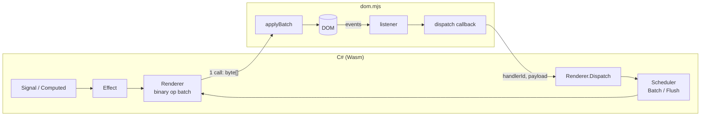

# NetWasm.UI

A reflection-free, signal-driven C# UI framework for the browser, compiled ahead-of-time to
WebAssembly with [NetWasm](https://www.netwasm.com). Inspired by Solid and Svelte rather than
Blazor: components build their DOM once, fine-grained signals patch exactly the nodes that
changed, and every state change crosses the Wasm→JS boundary **at most once**.

> Status: proof of concept. The core works end-to-end in the browser (see `samples/Counter`),
> but the API will change.

## Why

NetWasm is a closed-world AOT toolchain: no reflection, no `System.Linq`, no runtime code
generation — and a tiny output. Blazor-style render trees and reflection-driven binding do not
fit that model. NetWasm.UI instead uses:

- **Signals** (`Signal<T>`, `Computed<T>`, `Effect`) with automatic dependency tracking.
- **Build-once components** – `Build()` runs exactly once; reactive expressions
  (`Func<T>` / signals) create targeted effects on single text nodes, attributes or properties.
- **A binary op batch** – all DOM mutations in a tick are encoded into one `byte[]` and applied
  by a ~200-line JS decoder (`dom.mjs`) in a single call.
- **Events** flow back through one JS→Wasm callback (`dispatch(handlerId, payload)`), wrapped in
  a scheduler batch, so a click that touches ten signals still yields one `applyBatch`.

### Sample sizes (Counter + TodoList demo, Release)

| Artifact                | Raw     | Brotli  | Gzip    |
|-------------------------|---------|---------|---------|
| `Counter.wasm`          | 316 KB  | 59 KB   | 75 KB   |
| `netwasm.page.mjs` host | 315 KB  | 59 KB   | 70 KB   |
| **Whole page (10 requests)** | **649 KB** | **125 KB** | – |

Half of the download is NetWasm's own JS host, not application code. `tools/serve.py`
compresses with Brotli/gzip so DevTools "transferred" numbers match a production server.

## Quick look

```csharp
using NetWasm.UI;
using NetWasm.UI.Reactive;
using static NetWasm.UI.Html;

public sealed class CounterView : Component
{
    private readonly Signal<int> count = new(0);

    protected override Node Build()
    {
        var doubled = new Computed<int>(() => count.Value * 2);

        return Section(
            H2("Counter"),
            P("Count: ", Strong(Text(count)), " · doubled: ", Text(doubled)),
            Button(OnClick(() => count.Value++), "+1"),
            Button(Disabled(() => count.Value == 0), OnClick(() => count.Value = 0), "Reset"),
            When(() => count.Value >= 10, () => P("That's a lot of clicks!")));
    }
}
```

Lists are keyed and reconciled with a longest-increasing-subsequence diff, so reorders emit the
minimum number of `insertBefore` ops:

```csharp
Ul(Each(items, i => i.Id, item =>
    Li(
        Class(() => item.Done.Value ? "todo done" : "todo"),
        Label(Input(Type("checkbox"), Spread(Bind(item.Done))), " ", item.Title),
        Button(OnClick(() => Remove(item)), "×"))))
```

## Repository layout

| Path                         | What                                                                 |
|------------------------------|----------------------------------------------------------------------|
| `src/NetWasm.UI`             | Core: reactivity, binary renderer, component/builder API. Targets `netwasm0.1` and `net10.0` (for tests). |
| `src/NetWasm.UI.Browser`     | Browser host: `[JSImport]` bindings + `dom.mjs` decoder. `netwasm0.1` only. |
| `samples/Counter`            | Counter + TodoList demo app (`OutputType=JsModule`, page host).       |
| `tests/NetWasm.UI.Tests`     | xunit tests running against an in-memory `FakeDomHost` decoder.       |
| `tools/serve.py`             | Static dev server with correct `.mjs`/`.wasm` MIME types and Brotli/gzip (`pip install brotli` for Brotli). |

## Getting started

Prerequisites: .NET SDK 10.0.3xx, Python 3 (for the dev server). The NetWasm SDK is resolved
from `global.json` and downloads its host tooling on first restore.

```powershell
dotnet test                                   # core unit tests (net10.0)
dotnet publish samples/Counter -c Release     # → samples/Counter/bin/Release/netwasm0.1/publish
python tools/serve.py samples/Counter/bin/Release/netwasm0.1/publish 8765
# open http://localhost:8765/
```

## Architecture



### Render protocol

Opcode `u8`, integers little-endian `i32`, strings `u32` byte length + UTF‑8, booleans `u8`.
Defined in `src/NetWasm.UI/Dom/Op.cs`; the decoders in `dom.mjs` and `FakeDomHost.cs` mirror it.

| Op | Operands | Note |
|----|----------|------|
| CreateElement / CreateText / CreateAnchor | id, tag / text / – | anchors are comment nodes used as insertion markers |
| SetText, SetAttribute, RemoveAttribute, SetProperty, SetBoolProperty | id, … | |
| AppendChild, InsertBefore | parent/reference, child | `InsertBefore` uses `reference.parentNode` |
| Remove / Release | id | `Remove` detaches but keeps the handle; `Release` drops it and its listeners |
| AddListener / RemoveListener | id, event, handlerId, flags | flags: 1 = preventDefault, 2 = stopPropagation |
| Mount | id, selector | `document.querySelector(selector).appendChild` |
| Focus | id | |

Event payload convention (JS side): `input`/`change` → `target.value` (checkbox →
`"true"/"false"`), key events → `event.key`, otherwise `""`.

### Reactivity

- `Signal<T>` stores a value and its subscribers. Writing a changed value marks subscribers dirty.
- `Computed<T>` recomputes eagerly and only propagates if its value changed.
- `Effect` re-runs are queued on the `Scheduler`; at batch depth 0 the queue is flushed, then the
  `Renderer` ships one batch to the host.
- `Scope` owns disposables (effects, nested scopes, components) so `Show`/`For` branches tear
  down cleanly.

## Known limitations

- NetWasm 0.10 (`netwasm0.1`) has no `System.Linq`, reflection or `async`. Write plain loops.
- Globals (`Scheduler`, `Renderer`, tracker) mean exactly one app per module instance.
- Event payloads are strings only; no `DomEvent` property bag yet (clientX, modifiers, …).
- No routing, no SSR/hydration, no Razor syntax – components are built with the C# `Html` API.

## Roadmap ideas

- Razor-like syntax via a source generator that emits `Html` builder calls (no runtime cost).
- Richer event payloads (structured binary payload instead of a single string).
- Microtask-coalesced batching across multiple JS→Wasm events in one frame.
- Router, `<Suspense>`-style async boundaries once NetWasm supports async interop.
- Wasm size work: strip unused `Html` helpers, measure per-feature cost.

## Development notes

- Serve over `http://localhost` with correct MIME types (`tools/serve.py`); `file://` does not
  work and browsers cache a wrong `.mjs` MIME type aggressively (hard reload after fixing).
- `[JSImport]` methods are `static extern`; a `subscribe` host function must return an object with
  `dispose()` for `JSSubscription`.
- The JS module is declared by the **app** project
  (`<NetWasmJavaScriptModule Include="…/dom.mjs" Module="netwasm.ui.dom" />`) and is bundled into
  `netwasm.page.mjs`.

## License

MIT – see [LICENSE](LICENSE).
