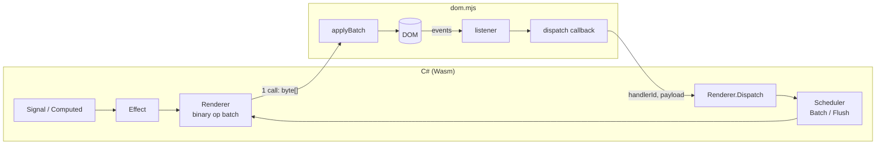

# NetWasm.UI

A reflection-free, signal-driven C# UI framework for the browser, compiled ahead-of-time to
WebAssembly with [NetWasm](https://www.netwasm.com). Inspired by Solid and Svelte rather than
Blazor: components build their DOM once, fine-grained signals patch exactly the nodes that
changed, and every state change crosses the Wasm→JS boundary **at most once**.

> Status: proof of concept. The core works end-to-end in the browser (see `samples/Counter`),
> but the API will change.

## Why

NetWasm is a closed-world AOT toolchain: no reflection, no `System.Linq`, no runtime code
generation — and a tiny output. Blazor-style render trees and reflection-driven binding do not
fit that model. NetWasm.UI instead uses:

- **Signals** (`Signal<T>`, `Computed<T>`, `Effect`) with automatic dependency tracking.
- **Build-once components** – `Build()` runs exactly once; reactive expressions
  (`Func<T>` / signals) create targeted effects on single text nodes, attributes or properties.
- **A binary op batch** – all DOM mutations in a tick are encoded into one `byte[]` and applied
  by a ~200-line JS decoder (`dom.mjs`) in a single call.
- **Events** flow back through one JS→Wasm callback (`dispatch(handlerId, payload)`) carrying a
  small binary `DomEvent` record (modifiers, button, clientX/Y, key, value, checked), wrapped in
  a scheduler batch, so a click that touches ten signals still yields one `applyBatch`.
- **Routing** – `Routes`/`Route`/`Link`/`NavLink` over the History API; patterns like
  `/todos/{id}` and `/files/{*path}`, plain clicks are intercepted, ctrl/middle-click and the
  back button behave like normal links.

### Sample sizes (Counter + TodoList demo, Release)

| Artifact                | Raw     | Brotli  | Gzip    |
|-------------------------|---------|---------|---------|
| `Counter.wasm`          | 316 KB  | 59 KB   | 75 KB   |
| `netwasm.page.mjs` host | 315 KB  | 59 KB   | 70 KB   |
| **Whole page (10 requests)** | **649 KB** | **125 KB** | – |

Half of the download is NetWasm's own JS host, not application code. The dev server
(`tools/DevServer`) compresses with Brotli/gzip so DevTools "transferred" numbers resemble a
production server.

## Quick look

Components can be written as `.nwui` templates (HTML + Razor-style `@`), compiled at build time
by a source generator into plain `Html` builder calls:

```razor
@* CounterView.nwui → public partial class CounterView : Component *@
<section>
    <h2>Counter</h2>
    <p>Count: <strong>@count</strong> &middot; doubled: @doubled</p>
    <button @onclick="() => count.Value++">+1</button>
    <button disabled="@(count.Value == 0)" @onclick="() => count.Value = 0">Reset</button>
    @if (count.Value >= 10) {
        <p class="hint">That's a lot of clicks!</p>
    }
</section>

@code {
    private readonly Signal<int> count = new(0);
    private Computed<int> doubled = null!;

    partial void OnInit() => doubled = new Computed<int>(() => count.Value * 2);
}
```

…or directly with the C# API, which is what the generator emits:

```csharp
using NetWasm.UI;
using NetWasm.UI.Reactive;
using static NetWasm.UI.Html;

public sealed class CounterView : Component
{
    private readonly Signal<int> count = new(0);

    protected override Node Build()
    {
        var doubled = new Computed<int>(() => count.Value * 2);

        return Section(
            H2("Counter"),
            P("Count: ", Strong(Text(count)), " · doubled: ", Text(doubled)),
            Button(OnClick(() => count.Value++), "+1"),
            Button(Disabled(() => count.Value == 0), OnClick(() => count.Value = 0), "Reset"),
            When(() => count.Value >= 10, () => P("That's a lot of clicks!")));
    }
}
```

Lists are keyed and reconciled with a longest-increasing-subsequence diff, so reorders emit the
minimum number of `insertBefore` ops:

```csharp
Ul(Each(items, i => i.Id, item =>
    Li(
        Class(() => item.Done.Value ? "todo done" : "todo"),
        Label(Input(Type("checkbox"), Spread(Bind(item.Done))), " ", item.Title),
        Button(OnClick(() => Remove(item)), "×"))))
```

## Repository layout

| Path                         | What                                                                 |
|------------------------------|----------------------------------------------------------------------|
| `src/NetWasm.UI`             | Core: reactivity, binary renderer, component/builder API. Targets `netwasm0.1` and `net10.0` (for tests). |
| `src/NetWasm.UI.Browser`     | Browser host: `[JSImport]` bindings + `dom.mjs` decoder. `netwasm0.1` only. |
| `src/NetWasm.UI.Generator`   | Roslyn incremental source generator: `*.nwui` templates → `Component` partial classes. |
| `samples/Counter`            | Demo app (`OutputType=JsModule`, page host): counter, todos, and `/components` (nested components, `.nwui` vs C#). |
| `tests/NetWasm.UI.Tests`     | xunit tests running against an in-memory `FakeDomHost` decoder.       |
| `tests/NetWasm.UI.E2E`       | Playwright (.NET) browser tests: publish + serve `samples/Counter`, drive it in Chromium. |
| `tools/DevServer`            | Kestrel dev server: publishes the app, serves it with Brotli/gzip and correct MIME types, watches sources and reloads the browser. |
| `tools/vscode-nwui`          | VS Code extension: `.nwui` syntax highlighting (TextMate grammar embedding HTML and C#). |

## Getting started

Prerequisites: .NET SDK 10.0.3xx. The NetWasm SDK is resolved from `global.json` and downloads
its host tooling on first restore.

```powershell
dotnet test tests/NetWasm.UI.Tests                 # core unit tests (net10.0, < 1 s)
dotnet run --project tools/DevServer -- samples/Counter
# → publishes, serves http://localhost:8765/ and rebuilds + reloads the browser on save
```

### Browser (E2E) tests

```powershell
dotnet build tests/NetWasm.UI.E2E
pwsh tests/NetWasm.UI.E2E/bin/Debug/net10.0/playwright.ps1 install chromium   # once
dotnet test tests/NetWasm.UI.E2E
```

The fixture starts the dev server (`--no-watch`, free port), waits for the first publish and runs
each test in a fresh Chromium context; any console error or uncaught page error fails the test.
`NETWASM_UI_E2E_URL=http://localhost:8765` reuses a server you already run, `HEADED=1` shows the
browser. `.github/workflows/ci.yml` runs build, unit tests, E2E tests and an `Oz` publish with a
size table in the job summary on `ubuntu-latest`.

Dev server options: `--port <n>`, `-O O0|O1|Oz` (NetWasm optimization, default `O1`),
`--release` (= `-O Oz`, production sizes), `-c Debug|Release`, `--no-watch` (serve only),
`--no-publish` (skip initial publish), `-w <dir>` (watch root, default repo root).

### Live reload, not hot reload

NetWasm is closed-world AOT: there is no runtime to patch, so .NET Hot Reload (Edit & Continue)
cannot apply. The dev server instead watches sources, re-runs `dotnet publish` and pushes a reload
over a WebSocket; build errors are shown as an overlay in the page. Saves that do not change file
content (editor touches, formatters) are ignored via content hashing. Preserving signal state
across reloads is on the roadmap.

#### Why `dotnet publish`, and how long it takes

The browser layout (`browser/*.mjs`, `netwasm.page.mjs`, `deployment.json`) is only produced by
the SDK's publish target, so a plain `build` is not enough. Measured on the Counter sample after a
one-line `.cs` change (NetWasm 0.10.0, Release):

| Step (MSBuild target)              | Oz (default) | Notes                                   |
|------------------------------------|-------------:|-----------------------------------------|
| `NetWasmCompileCoreModule`         |       ~7.2 s | AOT, scales with optimization level     |
| `NetWasmLinkRawModule`             |       ~5.9 s | wasm-ld + binaryen                      |
| `NetWasmSdkResolveBuildEnvironment`|       ~3.5 s | fixed: probes node/wasm-ld every run    |
| `NetWasmBuildRawBindings`          |       ~2.6 s |                                         |
| MSBuild + restore overhead         |       ~1.4 s |                                         |
| `NetWasmSdkPublishJsModule`        |       ~0.3 s | the actual "publish" part is negligible |
| **Total**                          |    **~21 s** |                                         |

| `NetWasmOptimization` | Publish after edit | `Counter.wasm` |
|-----------------------|-------------------:|---------------:|
| `Oz` (production)     |             ~21 s  |         316 KB |
| `O1` (dev default)    |             ~14 s  |         519 KB |
| `O0`                  |             ~12 s  |         615 KB |

`Debug` configuration is slower (~32 s) and larger (869 KB), so the dev server stays on Release.
The remaining floor is in the toolchain itself (environment probing, non-incremental AOT) and is
feedback for the NetWasm team rather than something this repo can shave further.

## Architecture



### Render protocol

Opcode `u8`, integers little-endian `i32`, strings `u32` byte length + UTF‑8, booleans `u8`.
Defined in `src/NetWasm.UI/Dom/Op.cs`; the decoders in `dom.mjs` and `FakeDomHost.cs` mirror it.

| Op | Operands | Note |
|----|----------|------|
| CreateElement / CreateText / CreateAnchor | id, tag / text / – | anchors are comment nodes used as insertion markers |
| SetText, SetAttribute, RemoveAttribute, SetProperty, SetBoolProperty | id, … | |
| AppendChild, InsertBefore | parent/reference, child | `InsertBefore` uses `reference.parentNode` |
| Remove / Release | id | `Remove` detaches but keeps the handle; `Release` drops it and its listeners |
| AddListener / RemoveListener | id, event, handlerId, flags | flags: 1 = preventDefault, 2 = stopPropagation, 4 = preventDefault only for a plain primary click |
| Mount | id, selector | `document.querySelector(selector).appendChild` |
| Focus | id | |

Event payload (JS → Wasm, `DomEvent.Decode`): `u8 flags, i32 button, i32 clientX, i32 clientY,
str key, str value` where flags = ctrl 1 | shift 2 | alt 4 | meta 8 | checked 16 | repeat 32.
An empty payload means "plain event, no data". `DomEvent.Encode()` is the C# reference encoder
used by tests; `payloadFor` in `dom.mjs` is the production encoder.

### Routing

```csharp
Routes(
    NotFound,                                      // optional fallback
    Route("/", Home),
    Route("/todos/{id}", p => new TodoPage(p.GetInt("id")).Render()),
    Route("/files/{*path}", p => Pre(p.Get("path"))))
```

- `Router.Install(IHistory)` is done by `BrowserApp.Start`; tests use `MemoryHistory`.
- `Router.Current.Path` is a signal (includes query/hash); `Navigate(path, replace)`;
  `IsActive(href, exact)` gives prefix-based active state used by `NavLink`.
- `Routes` rebuilds a page in a fresh `Scope` only when the matched route or its parameters
  change – a hash-only change does not rebuild.
- `Link` uses listener flag 4, so ctrl/shift/meta/middle clicks reach the browser untouched.
- The dev server serves `index.html` for extension-less paths; production hosts need the same
  SPA fallback, and `index.html`/`app.mjs` must use absolute asset URLs (`/browser/...`).

### Reactivity

- `Signal<T>` stores a value and its subscribers. Writing a changed value marks subscribers dirty.
- `Computed<T>` recomputes eagerly and only propagates if its value changed.
- `Effect` re-runs are queued on the `Scheduler`; at batch depth 0 the queue is flushed, then the
  `Renderer` ships one batch to the host.
- `Scope` owns disposables (effects, nested scopes, components) so `Show`/`For` branches tear
  down cleanly. Scopes form a tree that context lookups walk.

### Context, stores and lifecycle

```csharp
public sealed class AppState            // a "store" is just a class with signals
{
    public static readonly Context<AppState> Context = new("AppState");
    public Signal<int> Count { get; } = new(0);
}

// root component, while building:
Provide(AppState.Context, state);       // or Provide(ctx, value, () => subtree) for a scoped value
// any descendant (incl. Show/For branches and routed pages), while building:
var count = Use(AppState.Context).Count;

var input = Input();
OnMount(input.Focus);                   // after the host applied this update's DOM ops
OnCleanup(() => timer.Dispose());       // when the component/branch is torn down
```

- Contexts are keyed by the `Context<T>` instance (no reflection). `Use` throws if nothing was
  provided and there is no default. Call `Use` while building, not inside a reactive lambda.
- `OnCleanup` inside an `Effect` runs before the effect's next run and on dispose.
- `OnMount` runs once per build, in its own batch, and is skipped if its scope was disposed first.

## Templates (`.nwui`)

A `Foo.nwui` file becomes `public partial class Foo : Component` in `RootNamespace` + folder
(or `@namespace X.Y`). The generator only emits `Html`/`TemplateRuntime` calls, so there is no
template engine at runtime and nothing reflection-based for NetWasm to trip over. Wire it up in
the app's `.csproj` (see `samples/Counter/Counter.csproj`):

```xml
<ProjectReference Include="..\..\src\NetWasm.UI.Generator\NetWasm.UI.Generator.csproj"
                  OutputItemType="Analyzer" ReferenceOutputAssembly="false"
                  SetTargetFramework="TargetFramework=netstandard2.0" SkipGetTargetFrameworkProperties="true" />
<AdditionalFiles Include="**\*.nwui" Exclude="bin\**;obj\**" />
<CompilerVisibleProperty Include="RootNamespace;ProjectDir" />
```

| Syntax | Becomes |
|---|---|
| `@name`, `@a.b(c)[0]`, `@(x + 1)` | reactive text `Text(() => expr)`; a `Signal`/`Computed` prints (and tracks) its value |
| `@render(expr)` | any `Content` (node, component, fragment) inserted as-is |
| `class="a @b"`, `title="@x"` | static `Attr`, or reactive `Attr(name, () => …)` when it contains `@` |
| `disabled="@cond"` (also `checked`, `hidden`, `readonly`, `required`, `selected`, `multiple`, `autofocus`, `open`) | toggled attribute / `checked` property |
| `value="…"` | the `value` property (`Value(...)`) |
| `@onclick="() => …"`, `@onsubmit="Save"` | `On("click", handler)`; handler is `Action` or `Action<DomEvent>` |
| `@onclick:preventDefault`, `@onclick:stopPropagation`, `@onsubmit:preventDefault="false"` | listener flags (`submit` prevents default unless turned off) |
| `@bind="signal"` | `Spread(Bind(signal))` for `Signal<string>` / `Signal<bool>` |
| `@ref="field"` | assigns the `Element` (or component) to a generated field |
| `@if (c) { … } else if (c2) { … } else { … }` | `When(...)`; chains share one memoized selector |
| `@foreach (var x in items) { <li @key="x.Id">…</li> }` | keyed `Each(...)`; `items` may be a list expression or an `IReadOnlySignal<IReadOnlyList<T>>`; without `@key` the item is the key |
| `<Badge Label="hi" Count="@n" />` | `new Badge { Label = "hi", Count = n }` (uppercase tag = component) |
| `<Card>…</Card>` | `new Card { ChildContent = new Slot(() => …) }`; render it inside `Card` with `@render(ChildContent)` |
| `<Card><template slot="Header">…</template>…</Card>` | a named slot: `Header = new Slot(() => …)`, the rest still goes to `ChildContent` |
| `<Link href="/x">…</Link>`, `<NavLink href="/x" activeClass="on">…</NavLink>` | `Html.Link` / `Html.NavLink` |
| `@code { … }`, `@using X`, `@namespace X` | class members, usings, namespace |
| `@prop int Level = 1;` | a reactive prop: `public Prop<int> Level { get; set; } = 1;` |
| `@* … *@`, `<!-- … -->`, `@@`, `&amp; &times; &minus; &#65;` | comments, literal `@`, decoded entities (common named ones plus numeric; an unknown `&name;` is an error) |

- `Build()` calls `partial void OnInit()` first, inside the component's scope; implement it in
  `@code` to call `Use`, `Provide`, `OnMount` or create `Computed`s.
- Whitespace follows JSX: text on one line is kept, multi-line text is trimmed per line and joined
  with single spaces, whitespace-only lines disappear.
- Each template, `@if`/`else` block and `@foreach` body must have exactly one root node; `@if` and
  `@foreach` must sit inside an element.
- Plain component props (`public int Count { get; set; }`) are evaluated once when the parent
  builds; literal props are strings.
- Reactive props: declare `@prop Type Name [= default];` (or any `Prop<T>` property, also in
  hand-written C# components). The parent then passes `Level="@level"` / `Label="Hi @name.Value"`
  as a getter (`Level = new(() => level)`), so the child follows the parent's signals. Read it
  with `@Level`, `@if (Level > 3)`, `class="@(…)"` or `Level.Value` inside a `Func`; those reads
  are tracked. Reading `Level.Value` in `OnInit`/`@code` gives a snapshot (`Build` is untracked).
  From C#: `new Chip { Caption = nameSignal }`, `new Chip { Caption = new(() => …) }` or
  `Caption = "fixed"`. `samples/Counter/Page.nwui` uses `@prop string Title`.
- Literal props are strings, so pass other types as code: `Step="@(2)"`, `Max="@max"`.
- `samples/Counter/Components` shows nesting: `Panel` (slots) and `Stepper` (`@prop`, two-way `Signal<int>`)
  are templates, `ProgressBar` is a C# component, and `RoomRazor.nwui` / `RoomCode.cs` build the same UI
  from them, once as a template and once in C# (`new Panel { Title = …, ChildContent = new Slot(…) }`).
- Child content: declare `public Slot? ChildContent { get; set; }` (and any named slots, e.g.
  `Header`) and place it with `@render(ChildContent)`; an unset slot renders nothing. The content
  is built where the component renders it, so it belongs to the component's scope (and is torn
  down with it) while still reading the parent's signals. `samples/Counter/Page.nwui` is an example;
  from C#, `new Card { ChildContent = new Slot(() => P("hi")) }`.
- Template errors are `NWUI001` (syntax), `NWUI002` (structure), `NWUI003` (unsupported) with the
  position in the `.nwui` file. User C# is emitted under `#line`, so C# errors point at the template line and column, e.g. `CounterView.nwui(3,69): error CS0103`.
- The dev server watches `.nwui` files like `.cs` files.

### Editor support

`tools/vscode-nwui` is a small VS Code extension that highlights `.nwui` files. It uses VS Code's
own HTML and C# grammars, so markup, `@expressions`, `@if`/`@foreach`, directive attributes
(`@onclick="…"`), components, `@prop` and `@code { … }` get their normal colors. It also sets up
`@* *@` comments, bracket matching and auto-closing. Install it:

```powershell
cd tools/vscode-nwui
npm install
npm run package                     # → nwui.vsix
code --install-extension nwui.vsix
npm test                            # grammar tests (vscode-textmate + the real HTML/C# grammars)
```

The extension only colors the code. There is no IntelliSense or go-to-definition inside templates yet;
C# errors still show up in the build and point at the `.nwui` line.

## Known limitations

- NetWasm 0.10 (`netwasm0.1`) has no `System.Linq`, reflection or `async`. Write plain loops.
- Globals (`Scheduler`, `Renderer`, tracker, `Router.Current`) mean exactly one app per module instance.
- No base-path/hash routing, no SSR/hydration.
- `.nwui` editor support is syntax highlighting only (VS Code, `tools/vscode-nwui`), with no
  IntelliSense inside templates. Control flow is only `@if`/`@foreach`, and slots take no
  parameters (no `Slot<T>` yet).
- Pages are rebuilt on navigation; keep state that should survive in a store provided via context
  (see `samples/Counter/AppState.cs`).

## Roadmap ideas

- Templates: parameterized slots (`Slot<T>`), `@switch`, a language server for `.nwui`
  (IntelliSense via the generated C#), and a NuGet package that wires the generator up automatically.
- Microtask-coalesced batching across multiple JS→Wasm events in one frame.
- `<Suspense>`-style async boundaries once NetWasm supports async interop; nested/layout routes.
- Wasm size work: strip unused `Html` helpers, measure per-feature cost.
- Dev loop: snapshot/restore signal state across live reloads, CSS swap without reload, faster
  incremental NetWasm publish.
- Production caching: NetWasm emits stable file names but a `buildFingerprint` in `deployment.json`;
  an opt-in publish step could move `browser/` to `v/<fingerprint>/` (import map in `index.html`)
  so hosts can serve it with `Cache-Control: immutable` and browsers keep the compiled wasm cached.

## Development notes

- Serve over `http://localhost` with correct MIME types (`tools/DevServer`); `file://` does not
  work and browsers cache a wrong `.mjs` MIME type aggressively (hard reload after fixing).
- `[JSImport]` methods are `static extern`; a `subscribe` host function must return an object with
  `dispose()` for `JSSubscription`.
- The JS module is declared by the **app** project
  (`<NetWasmJavaScriptModule Include="…/dom.mjs" Module="netwasm.ui.dom" />`) and is bundled into
  `netwasm.page.mjs`.

## License

MIT – see [LICENSE](LICENSE).
