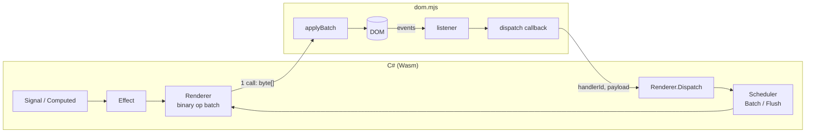

# Architecture

## Why not a Blazor-style render tree?

NetWasm is a closed-world AOT toolchain: no reflection, no `System.Linq`, no runtime code
generation, and a small output. Blazor-style render trees and reflection-driven binding do not
fit that model. NetWasm.UI instead uses:

- **Signals** (`Signal<T>`, `Computed<T>`, `Effect`) with automatic dependency tracking.
- **Build-once components.** `Build()` runs exactly once; reactive expressions (`Func<T>` or
  signals) create targeted effects on single text nodes, attributes or properties.
- **A binary op batch.** All DOM mutations in a tick are encoded into one `byte[]` and applied by
  a small JS decoder (`dom.mjs`) in a single call.
- **One event entry point.** Events flow back through one JS→Wasm callback
  (`dispatch(handlerId, payload)`) carrying a small binary `DomEvent`. The handler runs in a
  scheduler batch, so a click that writes ten signals still yields one `applyBatch`.

The result: every state change crosses the Wasm→JS boundary **at most once**.



## Projects

| Project | Role |
|---|---|
| `src/NetWasm.UI` | Reactivity, renderer, components, `Html` API, router. Targets `netwasm0.1` and `net10.0` (for tests). Has no browser dependency. |
| `src/NetWasm.UI.Browser` | `[JSImport]`/`[JSExport]` bindings, `BrowserApp`, browser history and `dom.mjs`. `netwasm0.1` only. |
| `src/NetWasm.UI.Generator` | Roslyn incremental source generator for `.nwui` templates (`netstandard2.0`). |

The core talks to the browser through `IDomHost` (`ApplyBatch`), so unit tests run on `net10.0`
against `FakeDomHost`, an in-memory decoder of the same protocol.

## Reactivity internals

- A `Signal<T>` keeps its subscribers in two-way links that remember their index on both sides
  (as in Solid), so subscribing and unsubscribing are O(1) even with thousands of readers.
- A `Computed<T>` recomputes eagerly when marked dirty and only propagates if its value changed.
- `Effect` re-runs are queued on the `Scheduler`. At batch depth 0 the queue is flushed and the
  `Renderer` ships one batch to the host; `OnMount` callbacks run after that, in their own batch.
- A `Scope` owns disposables (effects, nested scopes, components). Scopes form a tree that
  context lookups walk. `Each` rows get scopes detached from the owner (the list disposes them),
  so removed rows do not accumulate in the parent scope.
- Keyed lists (`Each`) diff old and new keys with a longest-increasing-subsequence pass and emit
  the minimum number of `InsertBefore` ops. The diff is non-generic (`KeyedList` over boxed keys)
  to keep the Wasm small.

## Render protocol

Opcode `u8`, integers little-endian `i32`, strings `u32` byte length + UTF‑8, booleans `u8`.
Defined in `src/NetWasm.UI/Dom/Op.cs`; the decoders in `dom.mjs` and `FakeDomHost.cs` mirror it.

| Op | Operands | Note |
|----|----------|------|
| CreateElement / CreateText / CreateAnchor | id, tag / text / – | anchors are comment nodes used as insertion markers |
| SetText, SetAttribute, RemoveAttribute, SetProperty, SetBoolProperty | id, … | |
| AppendChild, InsertBefore | parent/reference, child | `InsertBefore` uses `reference.parentNode`; appending to a comment inserts before it (template insertion points) |
| Remove / Release | id | `Remove` detaches but keeps the handle; `Release` drops it and its listeners |
| AddListener / RemoveListener | id, event, handlerId, flags | flags: 1 = preventDefault, 2 = stopPropagation, 4 = preventDefault only for a plain primary click |
| Mount | id, selector | `document.querySelector(selector).appendChild` |
| Focus | id | |
| DefineTemplate | templateId, html | parses the HTML into a `<template>` once and records the paths to its holes |
| CloneTemplate | templateId, firstId | clones it; the root gets `firstId`, hole *i* gets `firstId + i` |

Node ids are allocated in C#; `dom.mjs` keeps an id → node table and a per-node list of handlers
so releasing a node also drops its listeners.

## Static templates

`Template` (in `Template.cs`) scans its HTML for holes in C# without parsing it into nodes:
the root element, elements with a bare `$` attribute, `<!--$-->` (becomes an empty text node) and
`<!--@-->` (stays a comment and is used as an insertion point). `dom.mjs` finds the same holes
in the parsed `<template>`, so both sides agree on the numbering. A template is defined lazily
the first time it is cloned in a renderer generation; `Clone()` then reserves consecutive ids
and emits one `CloneTemplate` op. The generator turns every native element subtree of a
`.nwui` file into a static template, so only bound attributes, handlers, `@expr` text and
components/blocks cost ops per instance.

## Event delegation

Bubbling events in a fixed set (`click`, `dblclick`, `input`, `change`, `submit`, `keydown`,
`keyup`, pointer/mouse up/down, `focusin`/`focusout`, `contextmenu`, `beforeinput`) are not
attached per element. `AddListener` stores `[handlerId, flags]` on the node (`node.$$nw[type]`)
and `dom.mjs` adds one listener per type on `document` the first time it is
needed. On an event it walks `parentNode` from the target, applies each handler's flags, builds
the payload once and calls `dispatch`; `stopPropagation` ends the walk. Other events use a
direct listener. Delegated handlers run after native listeners on ancestors.

## Event payload

JS → Wasm, decoded by `DomEvent.Decode`:

```
u8 flags, i32 button, i32 clientX, i32 clientY, str key, str value
flags = ctrl 1 | shift 2 | alt 4 | meta 8 | checked 16 | repeat 32
```

An empty payload means "plain event, no data". `DomEvent.Encode()` is the C# reference encoder
used by tests; `payloadFor` in `dom.mjs` is the production encoder.

## Templates

The generator parses `.nwui` into a small tree (elements, text, `@expr`, `@if`, `@foreach`,
components, slots) and emits `Template`/`Html`/`TemplateRuntime` calls into a `partial class` with a
`Build()` override. Native elements become static templates (see above). User C# is emitted under `#line` directives so compiler errors point at the
template. See [Templates](templates.md).

## Globals

`Scheduler`, `Renderer`, the dependency tracker and `Router.Current` are static. That keeps the
code small and fast, but it means one app per Wasm module instance.
